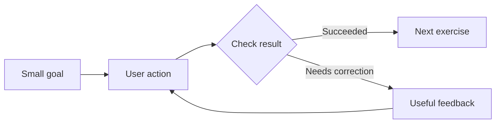

<p align="center"></p>

# oh-my-tutorial

**An AI skill for building tutorials people learn by doing.**

[한국어](README.md) · [Skill instructions](skills/oh-my-tutorial/SKILL.md) · [MIT License](LICENSE)

Give your coding agent a feature and a learning goal. This skill guides the agent through investigating the product, designing small exercises, connecting them to real behavior, and checking success, recovery, exit, and restart.

Think of the first quest in an RPG: a clear goal, one useful action, visible feedback, and another step when you are ready. Characters, rewards, and game styling are optional.

## See the idea


This is a standalone explanatory demo. An implementation in your project will follow its own features, design, and business rules. Open [docs/demo.html](docs/demo.html) locally to try the reservation lesson; its data stays in memory. The analytics and CSV cards illustrate other use cases.

The product builder installs the skill in a coding environment. End users learn through the tutorial that gets added to the product.

## Install in Codex

Paste this into a Codex conversation:

```text
$skill-installer https://github.com/99duuk/oh-my-tutorial/tree/main/skills/oh-my-tutorial
```

Use `$oh-my-tutorial` after installation. If it is missing from the skill list, restart Codex. The installable package lives in `skills/oh-my-tutorial`.

For manual installation, copy that entire directory to `~/.agents/skills/oh-my-tutorial` for personal use, or `<project>/.agents/skills/oh-my-tutorial` for one project. See the [official OpenAI skill documentation](https://learn.chatgpt.com/docs/build-skills) for discovery and invocation details.

## Use it

Open the target project in your coding environment, then ask:

```text
$oh-my-tutorial
Build a tutorial menu for the reservation feature so a new employee
can practice creating a reservation and checking the result.
```

Add useful context when you have it:

```text
$oh-my-tutorial
Create a tutorial for our inventory CSV import feature.
Teach a new operator to import valid rows, fix errors, and retry
only the failed rows. Reuse our demo data and existing design.
```

For design only, explicitly ask for a specification before implementation. For an existing tutorial, ask the skill to review and improve it.

## What it covers

| Part | Purpose |
|---|---|
| Learning menu | Choose a lesson, exit, and start again |
| Small exercises | Explain the goal, action, and expected result |
| Product integration | Use existing forms, controls, state, and rules |
| Completion checks | Confirm the intended result for the right object |
| Recovery | Handle invalid input, failure, retry, and interruption |
| Practice environment | Choose demo, temporary, current-work, or read-only data |
| Presentation | Fit the product's design and interaction needs |



## Across domains

| Product | Exercise | Evidence |
|---|---|---|
| Reservations | Create and reschedule a booking | The intended booking changes |
| Analytics | Filter data and compare periods | The displayed results match the query |
| CSV import | Correct and retry failed rows | The right job and rows complete |
| Orders | Move an order to the next stage | Its actual business state changes |
| Approvals | Submit a request and inspect its status | The request is accepted and visible |
| Editors | Select, move, and apply a change | The intended object reflects it |

These are design examples, not ready-made integrations. The agent must derive each product's actual goals and success conditions from its code and documentation.

## What to expect

The deliverable is a skill package: instructions, detailed references, and an optional TypeScript DOM-target helper. It requires an AI coding environment that can inspect and modify the target project. The installation guide targets Codex; use in other skill hosts requires their own installation and verification.

It does not guarantee a complete tutorial for every product in one attempt. Its purpose is to reduce repeated instructions and make important design and integration decisions more consistent. No particular tour library or onboarding service is required.

A save click is an attempt, not proof of a successful save. A queued job is distinct from a completed job. Partial success needs a retry strategy that preserves work already applied. Observing a screen does not automatically certify understanding.

## Verification

- The optional target helper has 23 browser checks, covering visibility, ambiguous targets, delayed rendering, cancellation, cleanup, slots, iframes, and responsive selection.
- Its runner checks TypeScript with `strict` and `noUncheckedIndexedAccess`.
- The public demo is checked for validation errors, successful creation, result confirmation, exit, restart, and narrow-screen layout.
- Product-specific business logic, server integration, and accessibility still need verification in the target project.

See [development and verification](docs/development.md) for commands and image reproduction. Skill guidance and detailed references are primarily written in Korean.

## Project map

```text
skills/oh-my-tutorial/  Installable skill, references, helper, and tests
docs/demo.html         Standalone explanatory demo
docs/images/           README screenshots and animation
docs/visuals/          Editable hero source
scripts/               Documentation and demo checks; image rendering
```

Start with [SKILL.md](skills/oh-my-tutorial/SKILL.md), [domain examples](skills/oh-my-tutorial/references/examples.md), or [open-source patterns](skills/oh-my-tutorial/references/open-source-patterns.md).

## Credits and license

Patterns were adapted or studied from [Usertour skills](https://github.com/usertour/skills), [Driver.js](https://github.com/nilbuild/driver.js), [embedded-uiux-walkthrough](https://github.com/Tanwyhang/embedded-uiux-walkthrough), and [Onborda](https://github.com/uixmat/onborda).

See [upstream notices](skills/oh-my-tutorial/references/upstream-notices.md) for attribution and scope. This project is released under the [MIT License](LICENSE).

Issues and pull requests with concrete use cases or reproducible fixes are welcome.
