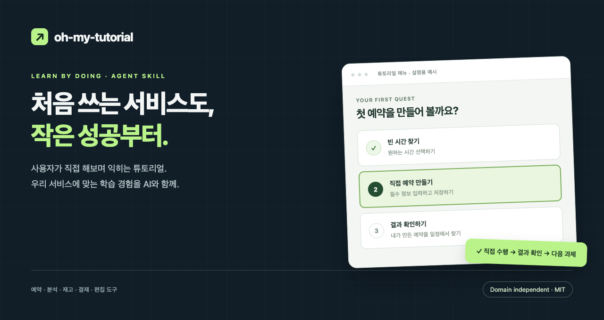
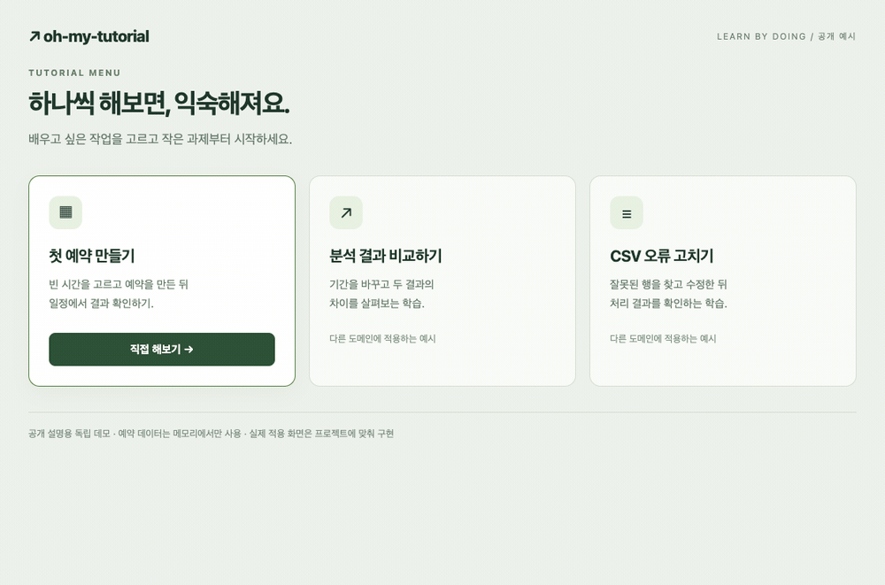
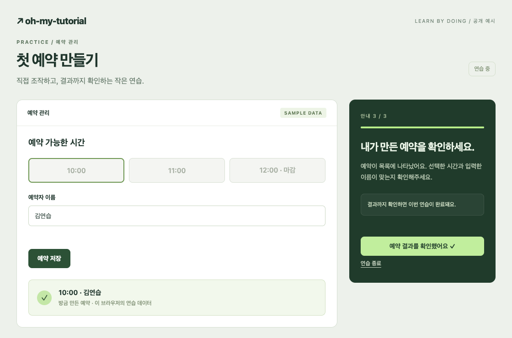
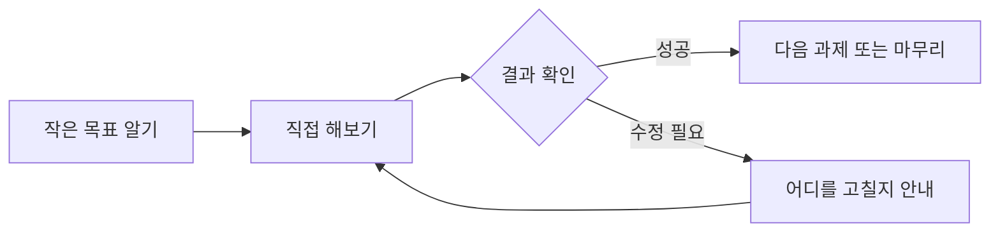
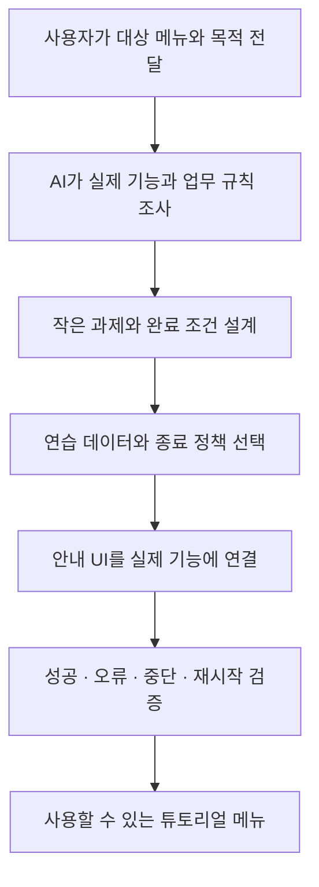

<p align="center">
  
</p>

<h1 align="center">oh-my-tutorial</h1>

<p align="center"><strong>우리 서비스의 사용법을, 직접 해보며 익히게.</strong><br>RPG의 첫 퀘스트처럼 자연스럽게 배우는 튜토리얼을 만드는 AI 스킬.</p>

<p align="center">
  <a href="LICENSE"></a>
  <a href="skills/oh-my-tutorial/SKILL.md"></a>
  <a href="https://github.com/99duuk/oh-my-tutorial/actions/workflows/verify.yml"></a>
</p>

<p align="center"><a href="#어떤-모습인가요">미리 보기</a> · <a href="#설치하기">설치</a> · <a href="#바로-사용하기">사용법</a> · <a href="#어떤-서비스에-쓸-수-있나요">적용 사례</a> · <a href="README.en.md">English</a></p>

## 한 문장으로 소개하면

**“이 메뉴를 처음 쓰는 사람이 직접 익힐 수 있게 만들어줘.”라는 요청을, 실제 서비스에 연결된 튜토리얼로 구체화하는 스킬.**

여기서 **스킬**은 AI 개발 도구가 작업할 때 참고하는 설명서와 재사용 자료 묶음. 어떤 기능을 가르칠지 조사하고, 작은 과제로 나누고, 사용자가 성공했는지 확인하고, 다시 연습할 수 있게 만드는 방법까지 포함.

예를 들어 예약 서비스라면 다음과 같은 학습 경험을 만드는 용도.

> **빈 시간 고르기 → 예약자 입력하기 → 예약 만들기 → 내가 만든 예약 확인하기**

서비스를 만드는 사람은 “어떤 메뉴를 누구에게 가르칠지” 전달하고, 완성된 튜토리얼을 사용하는 사람은 서비스 안에서 직접 연습하는 방식.

| 사용하는 사람 | 하는 일 |
|---|---|
| 서비스 제작자·개발자 | AI에게 스킬과 대상 메뉴를 지정해 튜토리얼 제작 요청 |
| 서비스를 처음 쓰는 사용자 | 만들어진 튜토리얼 메뉴에서 과제 수행과 결과 확인 |

스킬의 사용에는 **프로젝트 코드를 읽고 수정할 수 있는 AI 개발 환경**이 필요. 현재 설치·호출 안내의 기준은 Codex이며, 문서와 학습 원리는 다른 환경에서도 참고 가능.

## 어떤 모습인가요?



*공개 설명용 독립 데모. 스킬의 학습 방식을 보여주는 예시이며, 실제 프로젝트에 적용되는 화면과 디자인은 프로젝트에 따라 달라짐.*

움직이는 이미지 없이 읽는 순서:

1. **학습 선택** — “첫 예약 만들기”에서 직접 해보기 선택.
2. **작은 행동** — 빈 시간 하나를 선택하고 이름 입력.
3. **실수와 수정** — 이름이 비어 있으면 같은 단계에서 수정.
4. **실제 결과** — 저장한 시간과 이름이 예약 목록에 반영.
5. **학습 마무리** — 결과를 확인하고 종료하거나 다시 연습.



**직접 눌러보고 싶다면:** 저장소를 내려받은 뒤 [docs/demo.html](docs/demo.html)을 브라우저로 열어 체험 가능. 외부 서버 연결 없이 동작하며 예약은 메모리에만 유지. 데모에서 실제 체험 가능한 항목은 “첫 예약 만들기”. 분석·CSV 카드는 다른 적용 사례 소개용.

## 무엇이 들어 있나요?

스킬은 다음 결정을 AI가 빠뜨리지 않도록 안내하는 구성.

| 필요한 것 | 사용자가 경험하는 결과 |
|---|---|
| 학습 메뉴 | 배우고 싶은 작업 선택, 종료 후 다시 시작 |
| 작은 과제 | 지금 해야 할 행동과 그 이유를 이해 |
| 실제 기능 연결 | 기존 버튼·폼·목록·도구로 직접 수행 |
| 완료 확인 | 입력 성공, 생성된 항목, 바뀐 결과 등으로 달성 확인 |
| 실패와 복구 | 오류 수정, 재시도, 중단, 재시작 |
| 연습 환경 | 예시 데이터·임시 데이터·현재 작업 중 적절한 방식 선택 |
| 프로젝트에 맞는 표현 | 기존 디자인, 화면 크기, 키보드 조작에 맞춘 안내 |

게임에서 가져온 핵심은 **작은 목표 → 직접 행동 → 눈에 보이는 결과 → 다음 과제**. 캐릭터·경험치·보상 효과는 필요에 따른 선택 사항.



## 설치하기

### 가장 쉬운 방법: Codex에 설치 요청

Codex 대화창에 아래 내용을 붙여넣기.

```text
$skill-installer https://github.com/99duuk/oh-my-tutorial/tree/main/skills/oh-my-tutorial
```

설치 안내가 끝나면 다음 대화에서 `$oh-my-tutorial`로 호출. 목록에 보이지 않을 때는 Codex 재시작 후 확인. 저장소의 `skills/oh-my-tutorial` 폴더가 설치할 스킬의 전체 내용.

GitHub 저장소에서 설치하는 방식과 스킬 호출·탐색 위치는 [공식 OpenAI 스킬 문서](https://learn.chatgpt.com/docs/build-skills) 참고.

<details>
<summary>직접 파일을 복사해서 설치하기</summary>

1. 이 저장소를 다운로드하거나 아래 명령으로 복제.

   ```sh
   git clone https://github.com/99duuk/oh-my-tutorial.git
   ```

2. 저장소 안의 `skills/oh-my-tutorial` 폴더 전체를 원하는 설치 위치에 복사.

   | 설치 범위 | 복사할 위치 |
   |---|---|
   | 내 모든 프로젝트 | `~/.agents/skills/oh-my-tutorial/` |
   | 특정 프로젝트만 | `<프로젝트>/.agents/skills/oh-my-tutorial/` |

3. 복사한 폴더 바로 아래의 `SKILL.md` 존재 여부 확인. 같은 이름의 스킬이 이미 있다면 기존 설치 위치를 확인한 뒤 업데이트.

위 경로는 현재 공식 Codex 문서의 수동 설치 기준. 별도 설정을 사용하는 환경에서는 해당 환경의 스킬 디렉터리 사용.

</details>

## 바로 사용하기

### 1. 대상 프로젝트 열기

튜토리얼을 추가할 프로젝트를 AI 개발 도구에서 열고, 관련 코드에 접근 가능한 상태로 준비.

### 2. 가르칠 메뉴 지정하기

아래 문장에서 메뉴 이름만 프로젝트에 맞게 변경.

```text
$oh-my-tutorial
이 프로젝트의 예약 관리 메뉴를 처음 사용하는 직원이
직접 익힐 수 있도록 튜토리얼 메뉴를 만들어줘.
```

대상 메뉴와 목적이 분명하면 짧은 요청으로도 시작 가능. 실제 기능·코드에서 확인할 수 있는 내용은 AI가 조사하는 흐름.

### 3. 우리 서비스에 필요한 부분 조정하기

추가 조건이 있으면 같은 요청에 함께 전달.

```text
$oh-my-tutorial
재고 CSV 가져오기 메뉴의 튜토리얼을 만들어줘.
대상은 처음 사용하는 운영 직원이야.
정상 등록과 오류 행 수정·재시도를 배우게 해줘.
기존 데모 데이터를 사용하고, 현재 디자인을 따라줘.
```

**구현 전에 설계부터 보고 싶다면:**

```text
$oh-my-tutorial
분석 대시보드에서 기간·지역을 바꾸고 결과를 비교하는
튜토리얼의 명세만 먼저 작성해줘.
```

**이미 있는 튜토리얼을 개선하고 싶다면:**

```text
$oh-my-tutorial
현재 튜토리얼을 검토하고 개선해줘.
사용자가 직접 조작하는 흐름, 완료 판단,
오류 후 재시도와 모바일 배치를 우선 확인해줘.
```

## 어떤 서비스에 쓸 수 있나요?

**공통으로 가져가는 것은 학습 방법. 각 서비스의 업무 규칙과 성공 조건은 새로 조사.**

| 서비스 | 직접 해보는 과제 | 완료를 확인하는 근거 |
|---|---|---|
| 예약 관리 | 빈 시간에 예약을 만들고 시간 변경 | 해당 예약의 생성·변경 결과 |
| 분석 대시보드 | 기간과 지역을 바꾸고 이전 결과와 비교 | 선택 조건에 맞게 갱신된 결과 |
| 재고·CSV 가져오기 | 잘못된 행을 수정하고 다시 처리 | 대상 작업 결과와 남은 오류 행 |
| 주문 관리 | 주문을 찾아 출고 준비 상태로 변경 | 그 주문의 실제 처리 상태 |
| 문서 결재 | 필요한 정보를 채우고 결재 요청 | 요청 접수와 대기 상태 |
| 편집 도구 | 요소 선택·이동·적용 | 선택한 대상의 실제 변경 결과 |

위 표는 적용 예시. 특정 서비스용 완성 템플릿이나 모든 도메인의 연동을 제공한다는 의미는 없으며, 프로젝트의 실제 기능에 맞춘 구현이 필요.

더 자세한 판단 예시는 [도메인별 적용 사례](skills/oh-my-tutorial/references/examples.md) 참고.

## 요청하면 어떤 순서로 작업하나요?



명세만 요청한 경우에는 설계 산출물까지 진행. 구현 요청의 경우에는 실제 기능 연결과 검증까지 수행하도록 안내.

### “다음 버튼을 눌렀다”와 “배웠다”의 차이

예약 생성 과제라면 저장 버튼 클릭은 시도. 유효성 검사 실패나 저장 실패가 발생하면 같은 과제에 머물고, **해당 예약이 만들어진 결과**를 확인한 뒤 진행.

오래 걸리는 작업에서는 “접수됨”과 “처리 완료”를 구분. 일부 행만 처리됐다면 성공한 행을 보존하고 제품의 재시도 방식에 맞춰 오류 행을 처리. 화면 이동과 튜토리얼 종료가 실제 업무 작업의 상태 갱신까지 끊지 않도록 설계.

관찰·비교 학습에서는 결과 해설과 확인으로 진행 가능. 화면을 봤다는 사실만으로 사용자의 이해도를 자동 인증하지 않는 기준.

## 기대할 수 있는 범위

| 이 저장소가 제공하는 것 | 프로젝트에서 결정·확인할 것 |
|---|---|
| 학습 설계와 구현 절차 | 실제 사용자, 업무 규칙, 가르칠 범위 |
| 성공·오류·중단 처리 기준 | 실제 기능의 완료 이벤트와 상태 |
| 안내 UI와 도구 선택 기준 | 디자인, 모바일 배치, 접근성 |
| 선택적인 DOM 대상 탐색 코드 | 기존 코드와의 연결 및 실행 검증 |
| 공개 데모와 테스트 실행기 | 운영 환경과 실제 사용자 경험 |

한 번의 요청으로 모든 서비스의 튜토리얼 품질을 보장하는 제품은 아님. 반복해서 설명하던 공통 요구를 스킬에 담아, 프로젝트 고유의 학습 내용과 품질 조정에 집중하는 것이 목표.

스킬 실행에 별도의 Usertour 계정이나 특정 UI 라이브러리는 불필요. AI 개발 도구 자체의 사용 조건과 비용은 해당 도구의 정책에 따름.

## 검증은 어디까지 되어 있나요?

| 검증 대상 | 확인 범위 |
|---|---|
| 스킬 패키지 | 필수 메타데이터, 문서 연결, 특정 로컬 경로 의존 여부 |
| 브라우저 대상 탐색 코드 | 실제 Chrome에서 23개 검사: 숨김·중복·지연·취소·슬롯·iframe·반응형 대상 선택 등 |
| 공개 데모 | 입력 오류, 결과 생성·확인, 종료, 재시작, 좁은 화면 |
| 도메인 적용 설계 | 예약·분석·CSV 가져오기 등의 목표와 완료 근거 검토 |

브라우저 코드 검사 결과가 임의의 서비스 전체, 실제 서버 연동, 모든 접근성 환경의 검증을 대신하지는 않음. 적용 프로젝트에서 실제 기능과 UI의 추가 확인 필요.

재현 명령과 이미지 생성 방법은 [개발·검증 안내](docs/development.md) 참고.

## 저장소 둘러보기

```text
oh-my-tutorial/
├── README.md                       # 지금 읽는 소개와 사용법
├── README.en.md                    # English introduction
├── docs/
│   ├── demo.html                   # 직접 눌러보는 공개 예시
│   ├── images/                     # README 이미지와 GIF
│   └── development.md              # 검증·이미지 재생성
├── scripts/                        # 문서·데모 검증 및 이미지 생성
└── skills/oh-my-tutorial/           # 설치할 스킬 폴더
    ├── SKILL.md                    # AI가 읽는 핵심 지침
    ├── agents/                     # 스킬 표시 정보
    ├── references/                 # 설계·구현·검증 상세 기준
    ├── assets/browser-target.ts    # 선택적인 브라우저 유틸리티
    └── scripts/                    # 유틸리티 회귀 검증
```

| 더 알고 싶은 내용 | 문서 |
|---|---|
| 무엇을 어떻게 가르칠지 | [조사와 학습 설계](skills/oh-my-tutorial/references/discovery-and-learning-design.md) |
| 어떤 결과를 성공으로 볼지 | [단계와 완료 조건](skills/oh-my-tutorial/references/step-and-completion-contracts.md) |
| 연습 데이터와 종료 처리 | [연습 환경과 생명주기](skills/oh-my-tutorial/references/practice-environment-and-lifecycle.md) |
| 안내 카드·강조·키보드 연결 | [안내 표현과 프로젝트 연결](skills/oh-my-tutorial/references/presentation-and-integration.md) |
| 공개 라이브러리 활용 | [공개 프로젝트의 구현 패턴](skills/oh-my-tutorial/references/open-source-patterns.md) |

## 참고한 프로젝트

| 프로젝트 | 참고·각색한 부분 |
|---|---|
| [Usertour skills](https://github.com/usertour/skills) | 독립 과제와 순차 흐름 구분, 맥락에 맞는 안내, 진단 방법 |
| [Driver.js](https://github.com/nilbuild/driver.js) | 강조·팝오버 연결, 비동기 준비와 표시 수명주기 |
| [embedded-uiux-walkthrough](https://github.com/Tanwyhang/embedded-uiux-walkthrough) | 실제 컴포넌트의 연습 화면, 좌표 처리, 숨겨진 대상 제외 |
| [Onborda](https://github.com/uixmat/onborda) | 제품 디자인에 맞게 교체 가능한 안내 카드 구조 |

각 프로젝트의 기여와 범위는 [출처·라이선스 고지](skills/oh-my-tutorial/references/upstream-notices.md)에 기록. 프로젝트별 채택 여부는 대상 서비스의 요구와 기존 구조에 따라 결정.

## 개선 제안과 라이선스

[Issues](https://github.com/99duuk/oh-my-tutorial/issues)에 적용한 서비스 종류, 기대한 학습 흐름, 실제 막힌 지점을 알려주면 개선에 도움. 민감한 데이터 대신 재현 가능한 작은 예시 권장.

새 도메인 사례, 더 명확한 지침, 재현 가능한 버그 수정의 PR 환영. [MIT License](LICENSE) 적용이며, 차용한 자료의 저작권·라이선스 고지 유지.
